# Doctor Tracker

**A secure admin portal for managing doctors, their patients and the trends behind them.**

[](https://github.com/habibullahmkc/doctor-tracker-frontend/actions/workflows/ci.yml)
[](https://github.com/habibullahmkc/doctor-tracker-backend/actions/workflows/ci.yml)

| | |
| --- | --- |
| **Live app** | https://doctor-tracker-psi.vercel.app |
| **Live API** | https://doctor-tracker-api-evvz.onrender.com/api/health |
| **Frontend repo** (this) | https://github.com/habibullahmkc/doctor-tracker-frontend |
| **Backend repo** | https://github.com/habibullahmkc/doctor-tracker-backend |
| **Demo login** | `admin@doctortracker.com` / `Admin@123` |

> The API runs on Render's free tier and sleeps when idle. The first request can take up to ~50 seconds.
> The login page shows a "waking up the server" notice while this happens.

---

## Description

Doctor Tracker gives a healthcare administrator one place to manage doctors and the patients under their care.
After signing in, the admin can register doctors, assign and update patients, track each patient's condition and
care status, and see the whole operation on an analytics dashboard: admissions over time, workload per doctor, and
breakdowns by condition, status and specialization. Every list is searchable, filterable and paginated on the server,
and backed by indexed MongoDB queries, so it stays fast as the data grows. The interface is responsive from phones
to wide screens and meets WCAG 2.1 AA.

## Features

| Area | What you can do |
| --- | --- |
| **Authentication** | Email/password sign-in, HttpOnly JWT cookie, every page and API route protected, rate-limited login |
| **Dashboard** | Totals with 8-month sparklines, admissions trend (7d / 30d / 12m), patients by status, top-10 patients per doctor, condition and specialization breakdowns, recent admissions |
| **Doctors** | Create, edit, delete. Search by name, hospital, specialization or email. Filter by specialization, hospital and joined date. Sort and paginate |
| **Doctor details** | Profile and patient counts by status. The doctor's own patient list with search and filters. Add, edit and remove patients |
| **Patients** | Search by name, phone or email. Filter by condition, status, gender, doctor and admission date. Edit, delete, reassign to another doctor |
| **Global search** | `Ctrl/⌘ + K` searches doctors, patients, conditions and specializations, fully keyboard-driven |
| **UX** | All list state lives in the URL (shareable, survives refresh and back). Skeletons, empty and error states, toasts, confirm dialogs. Mobile card layouts and a filter sheet |

## Tech Stack

| Layer | Choice |
| --- | --- |
| Frontend | **Next.js 16** (App Router), React 19, TypeScript, Tailwind CSS v4, shadcn/ui (Radix) |
| Data fetching | **TanStack Query** (server state) + **nuqs** (URL state) |
| Forms & validation | React Hook Form + Zod |
| Charts | Recharts (lazy-loaded) + dependency-free SVG sparklines |
| Backend | **Node.js + Express 5**, TypeScript, Mongoose, Zod |
| Database | **MongoDB Atlas** |
| Auth | JWT in an HttpOnly cookie, bcrypt, `jose` verification in Next.js `proxy.ts` |
| Hosting | Vercel (frontend) · Render (API) · MongoDB Atlas (database) |

---

## Setup Guide

### Prerequisites
- Node.js **20+** (developed on 22/24)
- A MongoDB connection string: a free [MongoDB Atlas](https://www.mongodb.com/atlas) cluster, or a local replica set (transactions are used when a doctor is deleted)

### 1. Backend (API)

```bash
git clone https://github.com/habibullahmkc/doctor-tracker-backend.git
cd doctor-tracker-backend
npm install
cp .env.example .env          # fill in MONGODB_URI and JWT_SECRET
npm run seed                  # demo admin + 25 doctors + 450 patients
npm run dev                   # http://localhost:5000/api/health
```

| Variable | Description |
| --- | --- |
| `MONGODB_URI` | MongoDB connection string, including the database name |
| `JWT_SECRET` | At least 32 characters. **Must match the frontend** |
| `JWT_EXPIRES_IN` | Session length, e.g. `1d` |
| `CLIENT_URL` | Allowed frontend origin(s), comma-separated, e.g. `http://localhost:1982` |
| `PORT` | Defaults to `5000` |
| `DNS_SERVERS` | *Optional, local only.* Set to `8.8.8.8,1.1.1.1` if you see `querySrv ECONNREFUSED` |

### 2. Frontend (this repo)

```bash
git clone https://github.com/habibullahmkc/doctor-tracker-frontend.git
cd doctor-tracker-frontend
npm install
cp .env.example .env.local    # set BACKEND_URL and JWT_SECRET
npm run dev                   # http://localhost:1982
```

| Variable | Description |
| --- | --- |
| `BACKEND_URL` | Base URL of the API, e.g. `http://localhost:5000` (no trailing slash) |
| `JWT_SECRET` | Same value as the backend. Used by `proxy.ts` to verify the session cookie |

Then open http://localhost:1982 and sign in with `admin@doctortracker.com` / `Admin@123`.

### Scripts

| Frontend | Backend |
| --- | --- |
| `npm run dev`: dev server on :1982 | `npm run dev`: API with hot reload |
| `npm run build` / `npm start`: production build | `npm run build` / `npm start`: compile and run |
| `npm run lint`: ESLint | `npm run lint`: Biome lint + format check |
| `npm run typecheck`: route types + TypeScript | `npm run typecheck`: TypeScript |
| `npm test`: Vitest unit tests | `npm test`: unit tests (`node:test`) |
| `npm run e2e:ui`: browser end-to-end (needs Chrome) | `npm run test:e2e`: API end-to-end (needs a running API) |
| `npm run e2e:a11y`: axe accessibility + keyboard | `npm run seed`: reset demo data |

Both repos run lint, typecheck, unit tests and a production build on every push (GitHub Actions). The end-to-end
suites take `BASE_URL`, so they run against a local stack or the live deployment, and they clean up after themselves.

---

## System Architecture

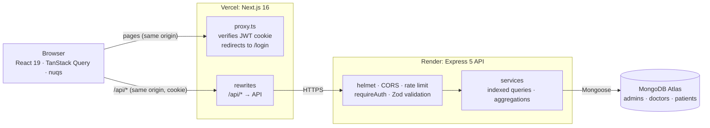

**How a request flows**

1. The browser opens `/patients`. `proxy.ts` runs on Vercel before rendering. It checks the `token` cookie with `jose`
   and redirects to `/login?next=/patients` if the cookie is missing or invalid.
2. The page reads its filters from the URL (nuqs) and asks TanStack Query for `/api/patients?condition=…&page=2`.
3. That call goes to the **same origin**. A Next.js rewrite forwards it to the Express API on Render, and the HttpOnly
   cookie travels with it.
4. Express runs helmet, CORS and cookie parsing, then `requireAuth` verifies the JWT. Zod validates the query string,
   and the service runs an indexed `find` + `countDocuments` in parallel.
5. The API returns `{ success, data, pagination }`. TanStack Query caches it and keeps the previous page on screen
   while the next one loads. Any create, update or delete invalidates doctors, patients and dashboard queries together.

**Data model.** Three collections. A patient references its doctor (`doctor: ObjectId`), so there is no array to keep
in sync. Deleting a doctor deletes their patients inside a transaction.

```
admins   { name, email (unique), password (bcrypt) }
doctors  { name, specialization, hospital, phone, email (unique), searchTokens[], createdAt }
patients { name, age, gender, phone, email, condition, status, admissionDate, notes, doctor → doctors._id, searchTokens[] }
```

**Frontend structure**

```
src/
├── app/
│   ├── (auth)/login/            # public sign-in
│   └── (dashboard)/             # protected: dashboard, doctors, doctors/[id], patients (+ error boundary)
├── components/
│   ├── ui/                      # shadcn/ui primitives
│   ├── layout/                  # sidebar, topbar, global search, notifications, mobile nav
│   ├── shared/                  # DataTable, Pagination, filters, dialogs, form fields, states
│   └── dashboard | doctors | patients/
├── hooks/                       # data hooks (TanStack Query), debounce, focus restore
├── lib/                         # api client, server prefetch, query keys, URL-state parsers, pure helpers (+ unit tests)
├── services/                    # typed API calls per resource
├── validations/                 # Zod form schemas (mirror the API rules)
└── proxy.ts                     # route protection (Next.js 16 "proxy", formerly middleware)
e2e/                             # browser end-to-end + accessibility suites (puppeteer, axe-core)
```

The backend follows a module-per-feature layout (`modules/{auth,doctors,patients,dashboard}` with
model / schema / service / controller / routes). See the [backend README](https://github.com/habibullahmkc/doctor-tracker-backend#readme)
for the full API reference and index list.

---

## Technical Decisions

### 1. A same-origin API proxy with HttpOnly cookie auth (instead of calling the API directly)

**Problem.** The frontend (`*.vercel.app`) and the API (`*.onrender.com`) live on different sites. If the browser
called the API directly, the session cookie would be a *third-party* cookie, which Safari and modern Chrome block. To
avoid that, people often keep the JWT in `localStorage`, but then any XSS bug can read the token.

**Decision.** The browser only ever talks to the Next.js origin. `next.config.ts` rewrites `/api/*` to the Express API,
so the API's `Set-Cookie` lands on the Vercel domain as a **first-party, HttpOnly, Secure, SameSite=Lax** cookie.

**What this gives us**
- Login works in every browser, with no cross-site cookie configuration.
- JavaScript can never read the token. SameSite=Lax plus same-origin requests also blunt CSRF.
- Because the cookie is first-party, **`proxy.ts` can verify it before rendering** and redirect unauthenticated users
  on the server, with no flash of protected content. The API still re-checks every request (`requireAuth`); the proxy
  is the UX layer and the API is the security boundary.
- CORS stays a strict allow-list, since browsers never make cross-origin calls.

**Trade-offs.** One extra network hop (Vercel → Render), and `JWT_SECRET` has to be configured in both services.
Behind the proxy the API sees Vercel's IP, so the login rate limiter counts only *failed* attempts per IP + email.
That way legitimate users sharing the proxy are never locked out. Putting both apps under one custom domain would have
removed the hop, but would have required owning a domain.

### 2. Database-level search, filtering, pagination and analytics, all backed by indexes

**Problem.** Search, filters and dashboard numbers have to stay fast as the collections grow. They can't depend on
loading everything into the browser.

**Decisions**
- **Everything happens in MongoDB.** Lists use `find().sort().skip().limit().lean()` and `countDocuments()` in
  parallel (`Promise.all`). The browser only receives the 10–100 rows it shows.
- **Search that can use an index.** An unanchored `/term/i` regex scans the whole collection, and `$text` only
  matches whole words ("sar" doesn't find "Sarah"). Each document instead stores lower-cased `searchTokens` (words from
  name, hospital, specialization, email or phone) with a multikey index. Anchored prefix regexes (`^sar`) use that
  index, so search-as-you-type works on any word. User input is regex-escaped.
- **Compound indexes in Equality → Sort → Range order**, one per real query shape, e.g. `{ condition: 1, admissionDate: -1 }`
  serves "condition = X, newest first, between these dates".
- **No N+1 queries.** Patient counts for a page of doctors come from one `$in` + `$group` aggregation, and the doctor
  shown on each patient row comes from one batched `populate`.
- **Dashboard aggregations run in parallel.** It uses `estimatedDocumentCount()` for totals, `$group` / `$lookup` for
  rankings, and `$dateToString` in the Asia/Dhaka time zone for daily or monthly buckets. Empty days are zero-filled
  on the server, so the chart never has gaps.

**Evidence** (from `explain("executionStats")` on the seeded data, where every query is an index scan and documents
examined equals documents returned):

```
doctors  search "sar"            IXSCAN searchTokens_1                  docsExamined 1   returned 1
doctors  specialization + sort   IXSCAN specialization_1_createdAt_-1   docsExamined 4   returned 4
patients condition + sort        IXSCAN condition_1_admissionDate_-1    docsExamined 10  returned 10
patients of one doctor + sort    IXSCAN doctor_1_admissionDate_-1       docsExamined 7   returned 7
```

- **Cached analytics with exact invalidation.** Dashboard results are cached for 60 seconds. Concurrent requests
  share one in-flight computation, and every doctor or patient write clears the cache, so the numbers are never stale.
  Unfiltered list totals use `estimatedDocumentCount()`, which reads collection metadata, and responses are gzipped.

**Scaling further.** Past a few hundred thousand rows I would switch deep pagination from `skip` to a cursor on
`(admissionDate, _id)`, move fuzzy search to Atlas Search, and move the cache to Redis once there is more than one
API instance.

### Also worth noting: data fetching and state
- **Server prefetch, client cache.** The dashboard page and the app shell prefetch their data on the server (the
  visitor's cookie is forwarded) and hand it to TanStack Query through `HydrationBoundary`. The first paint already
  has numbers, and the client keeps caching and refetching as usual. If the API is asleep, the prefetch gives up after
  3 seconds and the browser fetches instead, so a cold backend never blocks the page.
- **Same region.** Vercel functions run in Singapore (`sin1`), next to the API, so server-side fetches stay short.
- **No Redux.** Almost all state is *server* state, which TanStack Query already caches, deduplicates, refetches and
  invalidates. Filters, sort and page live in the URL (nuqs), and dialogs keep local state. A global store would only
  duplicate data that already has a better owner.

---

## Quality Checks

| Check | Result |
| --- | --- |
| Unit tests: backend 31 (`node:test`), frontend 14 (Vitest) | ✅ all pass, run in CI on every push |
| API end-to-end (70 checks: auth, CRUD, search, filters, pagination, validation, cascade delete, dashboard) | ✅ 70 / 70 against the live deployment |
| Browser end-to-end (35 checks: real Chrome, desktop + mobile, create/edit/delete flows) | ✅ 35 / 35 live, no console or hydration errors |
| Accessibility: axe-core, WCAG 2.1 AA, 12 pages and dialog states | ✅ 0 violations |
| Keyboard: skip link, focus ring, focus trap, Esc returns focus, menus and selects | ✅ 10 / 10 |
| Lighthouse: Accessibility / Best Practices / SEO | ✅ 100 / 100 / 100 on every page |
| Lighthouse: Performance (live) | Desktop: login 99, dashboard 99, patients 99 · Mobile: login 91, dashboard 75–78 |

Chart colors follow a validated palette: the patient-status colors pass color-vision-deficiency checks, and every
color comes with a text label. The admissions chart can also be switched to a table view.

---

## Visual Evidence

### Desktop

**Dashboard**

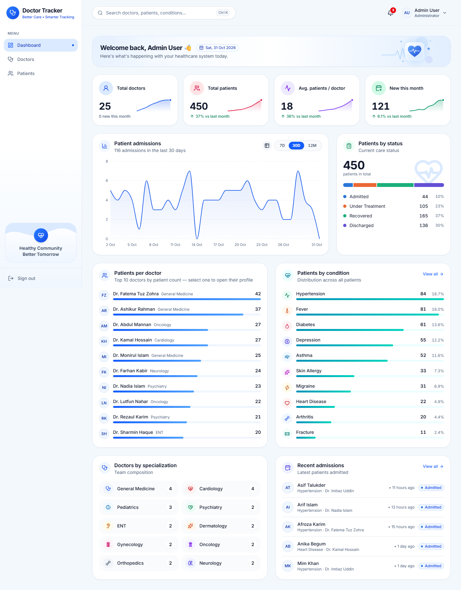

| Sign in | Doctors |
| --- | --- |
| 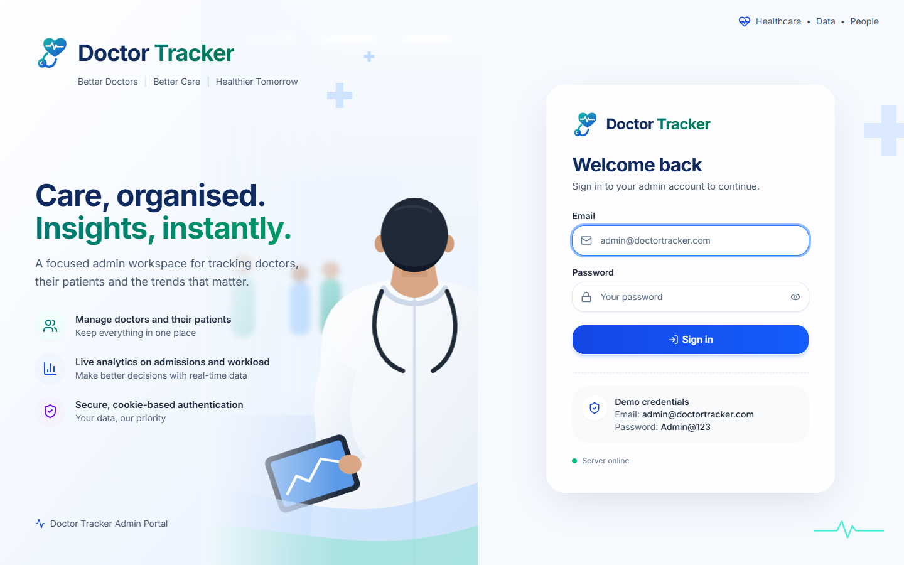 | 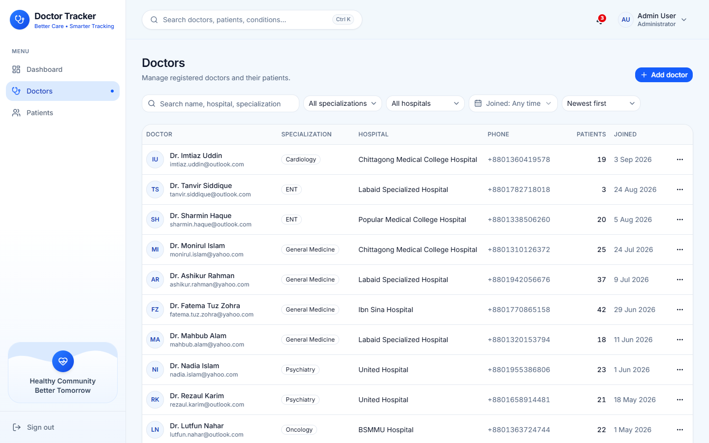 |
| **Doctor details** | **Patients (filtered)** |
| 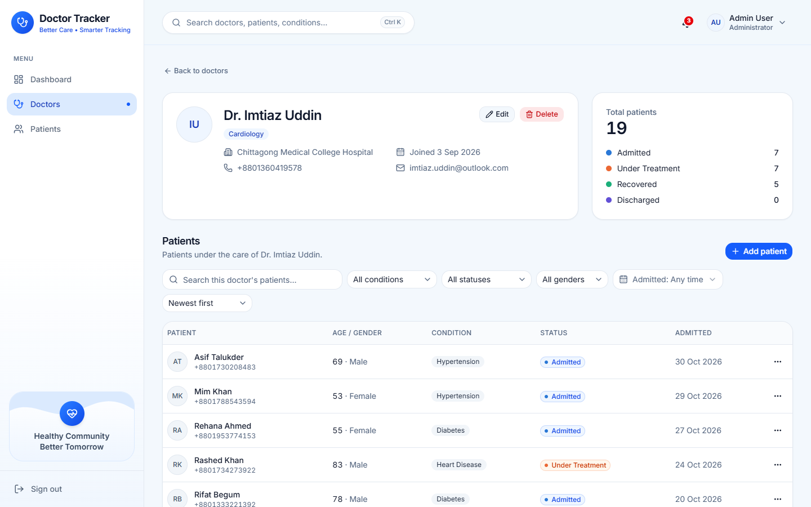 | 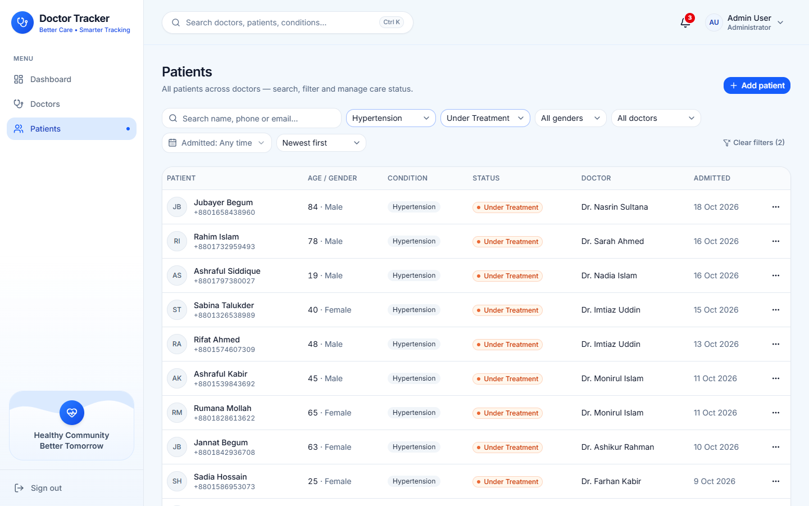 |
| **Form validation** | **Global search (Ctrl + K)** |
| 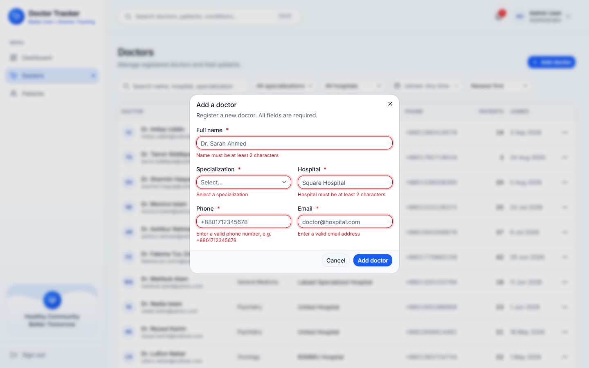 | 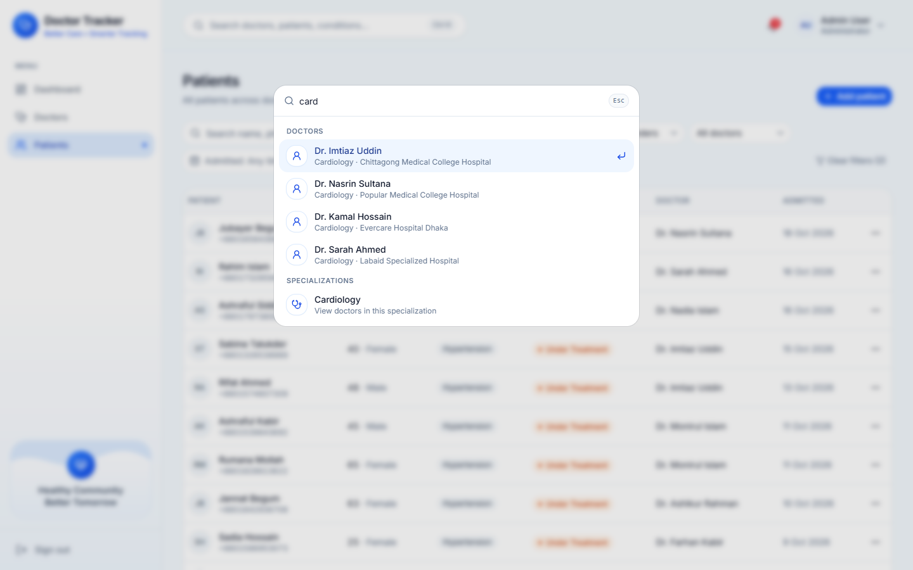 |

### Mobile

| Sign in | Dashboard | Charts |
| --- | --- | --- |
| 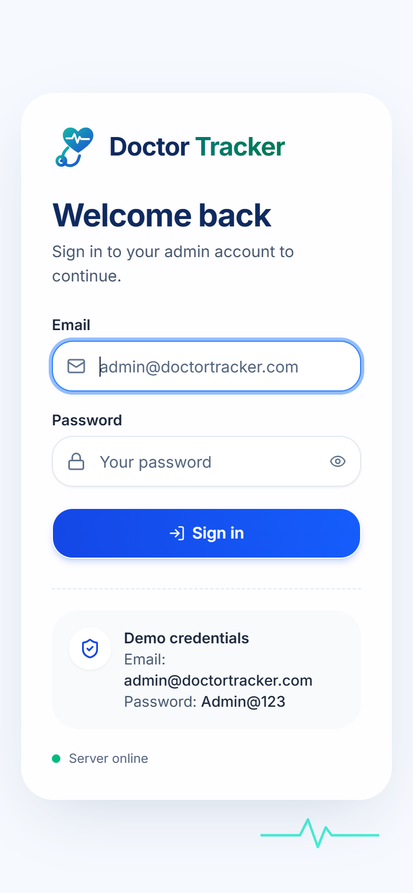 | 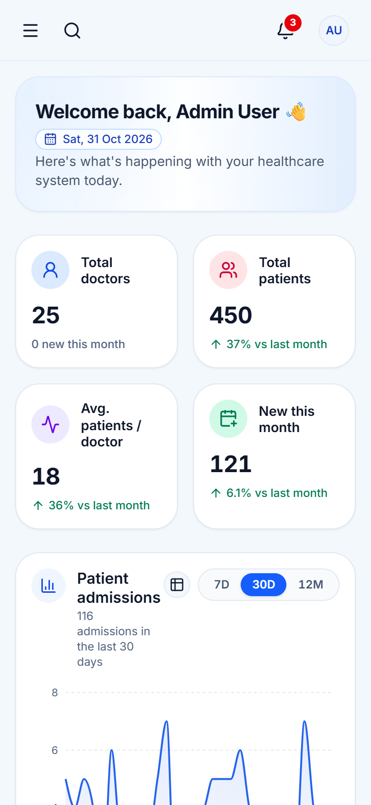 | 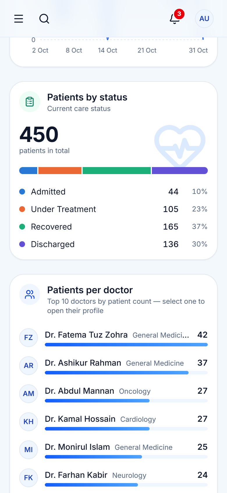 |
| **Navigation** | **Doctors** | **Patient filters** |
| 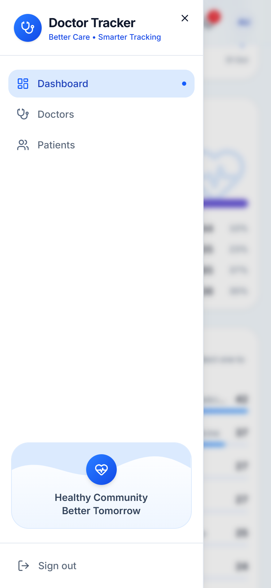 | 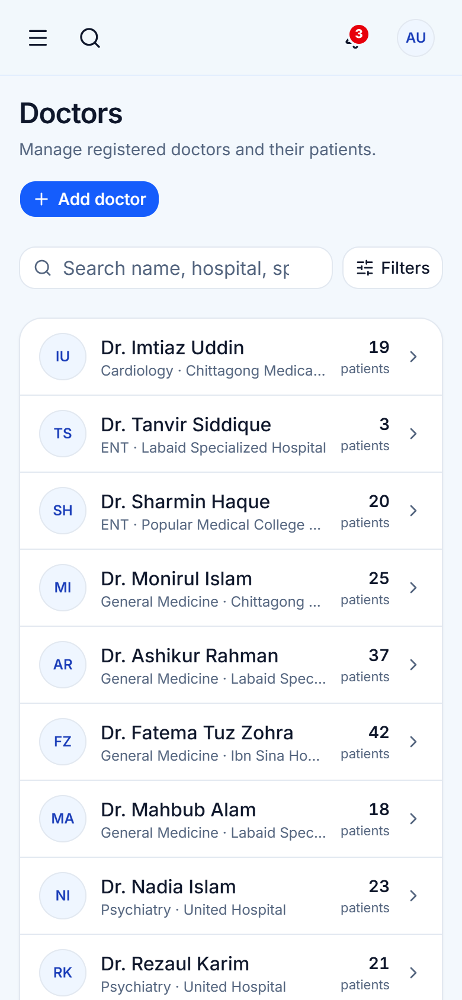 | 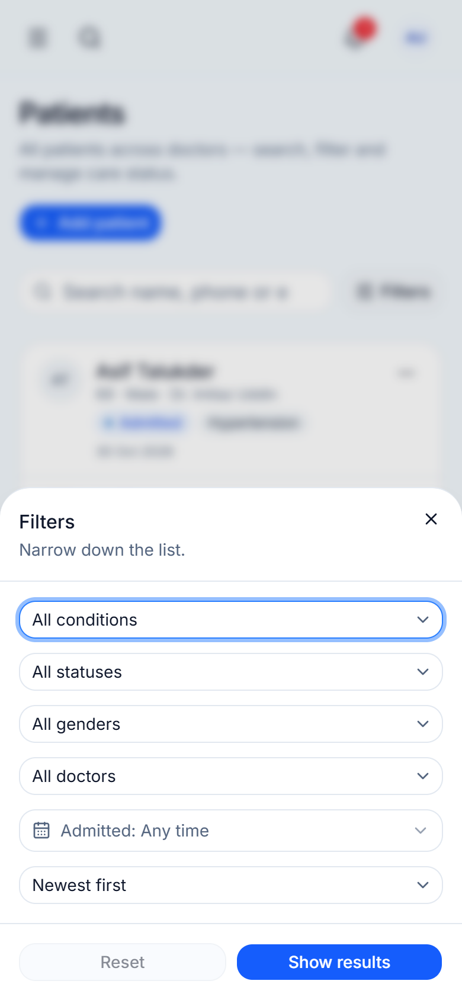 |

---

## Future Improvements
- Role-based access (admin vs read-only staff) and refresh-token rotation
- Cursor-based pagination and Atlas Search for very large datasets
- Run the end-to-end suites in CI against a disposable MongoDB replica set
- Server-render the first page of the doctor and patient lists, as the dashboard already does
